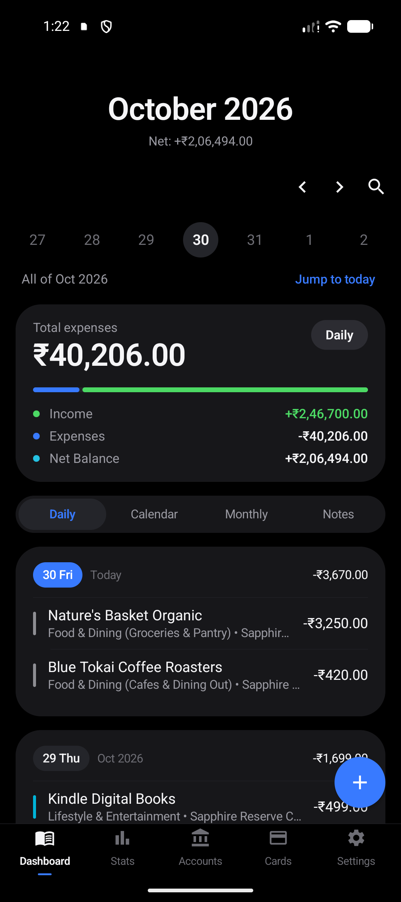
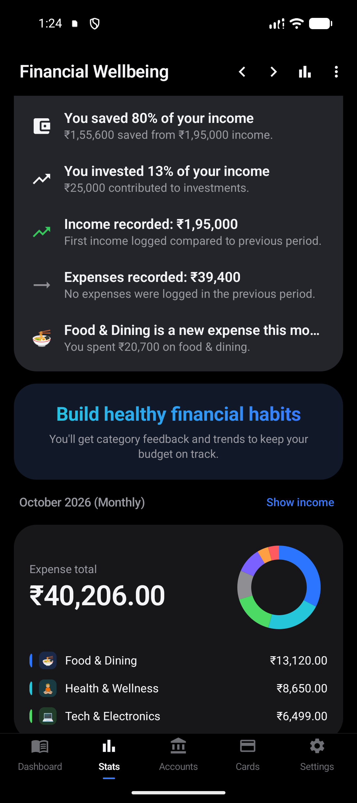
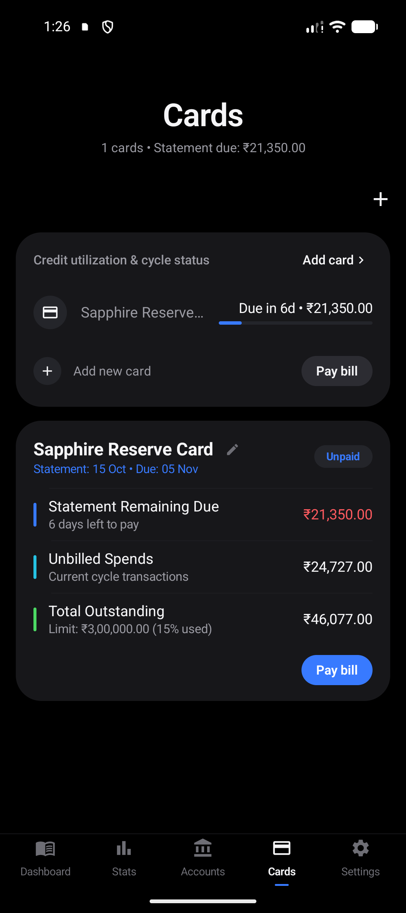
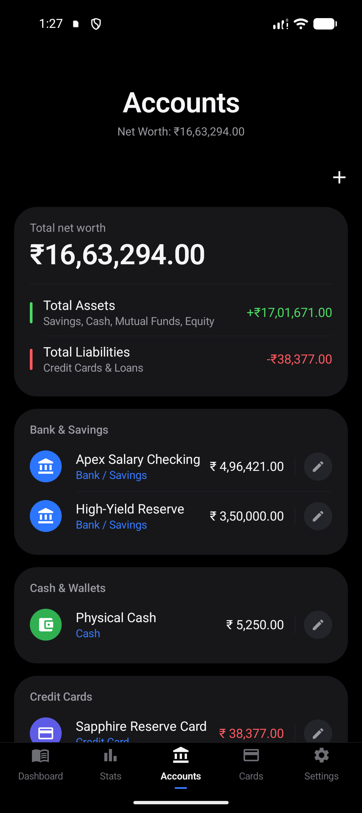

<div align="center">

# Money Manager

<p align="center">
  <strong>Your finances, strictly private and beautifully organized.</strong><br>
  An offline-first personal financial ledger and credit card management engine with Samsung One UI design aesthetics.
</p>

[](https://github.com/pritesh-ranjan/Money-Manager/actions)
[](https://github.com/pritesh-ranjan/Money-Manager/releases)
[-34A853?style=for-the-badge&logo=android&logoColor=white)](#prerequisites)
[](#-vault-security--privacy)
[](#license)

<br>

[](https://kotlinlang.org)
[](https://developer.android.com/jetpack/compose)
[](https://developer.android.com/training/data-storage/room)
[](#-vault-security--privacy)

</div>

---

## Screen Showcase

| **1. Dashboard & Ledger** | **2. Wellbeing & Money Story** | **3. Credit Cards Engine** | **4. Accounts & Net Worth** |
|:---:|:---:|:---:|:---:|
|  |  |  |  |
| *7-day date strip, monthly cashflow bar, category accents & quick filters* | *Interactive donut charts, weekly breakdown & pull-down Money Story* | *Cycle cutoff tracking, bill breakdowns & 1-tap statement settlement* | *Total asset/liability aggregation, balance adjustments & loyalty points* |

---

## Highlights

* **🔒 Zero-Network Privacy**: The app manifest completely omits `android.permission.INTERNET`. Zero cloud dependencies, zero external network telemetry, and zero tracking.
* **✨ Samsung One UI 9 Aesthetics**: Tactile squircle cards, bold collapsible headers, hairline inset dividers, and a battery-conserving pure AMOLED pitch-black dark mode (`#000000`).
* **📈 Monthly Money Story**: Pull-down intelligence layer providing month-over-month comparisons for living expenses, top category increases, savings rate, and investment contributions with underlying transaction drill-downs.
* **💳 Autonomous Credit Card Engine**: Tracks statement cutoffs, payment due windows, unbilled vs. billed balances, credit utilization, and offers 1-tap bill settlements.
* **⚡ Persistent Quick-Add Notification**: Always-available system notification tray with dedicated shortcuts to log Expenses, Income, or Transfers without opening the full app.
* **💾 Complete Data Sovereignty**: Export and restore your complete ledger to/from standard `.sqlite` database files with seamless backward compatibility for older backup formats.

---

## Feature Tour

### 📅 Dashboard & Ledger
* **7-Day Interactive Date Strip**: Quickly glance at your daily cashflow. Tap any day to isolate transactions, jump back to today, or switch to the entire month view.
* **Monthly Cashflow Summary**: Real-time totals for income, expenses, and net balance, accompanied by a dynamic visual cashflow bar.
* **Multi-View Navigation**: Switch seamlessly between **Daily** grouped view, **Calendar** view, **Monthly** summary, and **Notes** view.
* **Localized Indian Numbering System**: Native formatting (Lakhs and Crores, e.g., `₹1,12,342.50`) for clear, familiar readability.
* **Category Visual Indicators**: Elegant vertical color bars provide instant recognition of transaction categories at a glance.

### ⚡ Rapid Transaction Entry
* **Quick-Add Sheet**: Streamlined input with a large amount field, customizable currency preview, and instant transaction-type toggle (**Expense**, **Income**, **Transfer**, **Balance Adjustment**).
* **Predictive Note Suggestion Engine**: As you type a payee or note, Money Manager suggests matching past entries with historical frequency and automatically pre-selects the previously used category and account.
* **Contextual Tags**: Organize and group transactions across categories with custom tags (e.g., `#vacation`, `#work`, `#party`).
* **Continuous Logging ("Save & Continue")**: Add multiple transactions in a row without reopening the bottom sheet.
* **Precise Timestamps**: Backdate or record transactions using native date and time pickers.

### 🔔 Persistent Quick-Add Notification
* **Always-On Convenience**: An unobtrusive, ongoing status bar notification keeps quick financial tracking just a swipe away.
* **One-Tap Actions**: Dedicated buttons for **Add Expense**, **Add Income**, and **Transfer** let you record a transaction directly without launching the full app first.

### 💳 Credit Card Statement & Billing Engine
* **Cycle & Cutoff Tracking**: Define statement generation days (1–31) and payment due days (1–31) for each credit card.
* **Smart Bill Breakdown**: Automatically calculates:
  * Billed statement amount
  * Payments made since statement cutoff
  * Remaining statement balance due
  * Unbilled spends in the current cycle
  * Total outstanding card balance
* **Credit Limit & Utilization**: Visual progress bars display your credit utilization percentage with proactive warning indicators for high usage.
* **Due Date Alerts**: Real-time cycle statuses (**Paid**, **Due Soon**, **Overdue**, or **No Bill**).
* **One-Tap Bill Settlement**: Pay your credit card bill directly from any linked savings or cash account. Use quick-snap presets (*"Statement Due"* or *"Total Outstanding"*) or the precision slider to record settlements instantly.

### 🏦 Multi-Account & Net Worth Management
* **Diverse Account Types**: Support for Savings Accounts, Cash Wallets, Credit Cards, Linked UPI/Debit Accounts, Investments (FD/PPF/SGB), Equity & Stocks, Mutual Funds, and Loans.
* **Live Net Worth Tracking**: Continuously aggregates total assets and liabilities into an accurate net worth figure.
* **Static Revaluation (Balance Adjustments)**: Easily reconcile your recorded ledger with your real-world bank balance in one step—Money Manager automatically records the difference as an adjustment.
* **Multi-Currency & Custom Rewards**:
  * Track foreign currencies (USD, EUR, GBP, etc.) with custom exchange rates to your base currency.
  * Support for loyalty points, crypto, or miles (e.g., Reward Points, Scapia Coins) with configurable decimal precision.

### 📊 Financial Wellbeing & Analytics
* **Interactive Donut & Ring Charts**: Visual breakdown of your top spending categories for any period.
* **7-Day Stacked Bar Chart**: Daily expense patterns visualized with benchmark guidelines and highlighted active days.
* **Multi-Period Filtering**: Analyze spending by **Weekly**, **Monthly**, **Annually**, or **All-Time** windows.
* **Category Drill-Down**: Tap any category to inspect a breakdown of subcategories, transaction counts, and historical spends.

### ✨ Monthly Money Story
* **Intelligent Month-Over-Month Insights**: Pull down on the statistics screen to reveal a personalized financial story comparing your performance to the previous month (including equivalent partial-month comparisons for in-progress months).
* **Deep Insight Cards**:
  * **Expense Trends**: Percentage change in living expenses.
  * **Category Spends**: Highlights your most significant category increase or decrease.
  * **Income Growth**: Tracks month-over-month earning fluctuations.
  * **Savings Rate**: Calculates net income retained after living expenses.
  * **Investment Rate**: Measures contributions toward investments, equity, and mutual funds.
* **Drill-Down Inspection**: Tap any story insight to review all transactions contributing to that metric.

### 🔒 Vault Security & Privacy
* **100% Offline-First**: Network and internet access permissions are completely removed from the app manifest (`INTERNET` blocked). Your financial data never leaves your device.
* **PIN & Biometric Lock**: Secure your vault with a 4-digit PIN, fingerprint, or facial recognition.
* **PBKDF2-HMAC-SHA256 Cryptography**: Master PINs are salted and hashed using cryptographic industry standards.
* **Brute-Force Protection**: Automatic lockouts after repeated failed PIN attempts.
* **Privacy Screen Shield (`FLAG_SECURE`)**: Automatically obscures app previews in Android's recent apps switcher and protects against unauthorized screenshots.

### 💾 Backup, Restore & Legacy Migration
* **Standalone SQLite Backups**: Export your entire ledger (accounts, categories, tags, transactions) into a standard, portable `.sqlite` file at any time.
* **One-Tap Restore**: Restore your backup onto any device with atomic database integrity.
* **Legacy Backup Migration**: Directly import and migrate backups from older Money Manager schemas (`.mmbak` files and legacy tables including `INOUTCOME`, `ASSETS`, `ZCATEGORY`, `TX_TAG`, and `CURRENCY`).

---

## Tech Stack

| Layer | Technology |
|---|---|
| **Language** | [Kotlin 2.3.20](https://kotlinlang.org) (JVM Toolchain 17) |
| **UI Framework** | [Jetpack Compose](https://developer.android.com/jetpack/compose) with Material 3 |
| **Design System** | Custom Samsung One UI 9 Component Library |
| **Persistence** | [Room SQLite 2.8.5](https://developer.android.com/training/data-storage/room) with KSP |
| **Architecture** | Clean Architecture + MVVM (Coroutines, StateFlow, Repository Pattern) |
| **Security** | Android Biometrics API & PBKDF2-With-Hmac-SHA256 |
| **Build System** | Gradle 9.0.1 with Version Catalogs (`libs.versions.toml`) |

---

## Getting Started

### Prerequisites
* Android Studio Ladybug (2024.2+) or newer
* JDK 17
* Android SDK 36 (Min SDK 26)

### Build & Run
1. Clone the repository:
   ```bash
   git clone https://github.com/pritesh-ranjan/Money-Manager.git
   cd Money-Manager
   ```
2. Build the debug APK:
   ```bash
   ./gradlew assembleDebug
   ```
3. Run instrumented and local unit tests:
   ```bash
   ./gradlew test
   ```
4. Install directly to a connected device or emulator:
   ```bash
   adb install -r app/build/outputs/apk/debug/app-debug.apk
   ```

---

## License

This project is licensed under the MIT License - see the [LICENSE](LICENSE) file for details.
